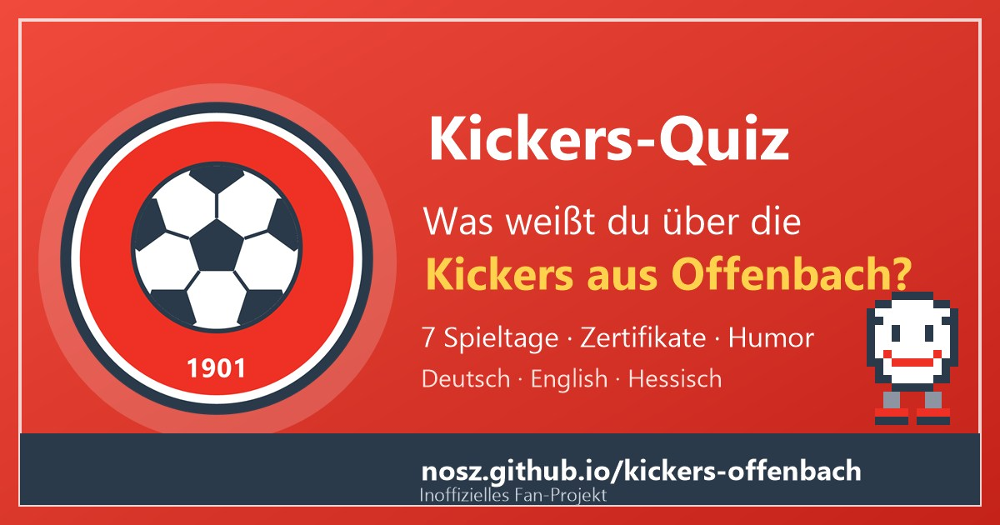

**⚽ Live ansehen: [https://nosz.github.io/kickers-offenbach/](https://nosz.github.io/kickers-offenbach/)**

# Kickers-Quiz: Kickers Offenbach

**Inoffizielles Fan-Projekt** rund um den O.F.C. Kickers 1901 e. V. Offenbach, ohne Verbindung zum Verein. Quiz, Humor und Zertifikate in **Deutsch, Englisch und Hessisch** (Offenbacher Mundart, liebevoll gemeint).

**Datei:** `index.html` (eine Datei, offline lauffähig, Version 1.0.1, Stand 23.10.2026). Einfach im Browser öffnen oder auf einem Webserver ablegen.

> **Veröffentlichung:** GitHub-Repository `kickers-offenbach` (Benutzer `nosz`), Adresse `https://nosz.github.io/kickers-offenbach/`. Alle Dateien der Liste unten ins Hauptverzeichnis des Repositories legen (ohne Unterordner), GitHub Pages auf den Hauptzweig (Branch) stellen. Bei anderer Adresse in `index.html` (canonical, og:url, og:image, twitter:image, `SHARE_URL`), in `manifest.webmanifest` (`id`) und in dieser README anpassen.

## Inhalt
Fan-Quiz mit 7 Spieltagen, Humor, Zertifikaten und Personalisierung, in **Deutsch, Englisch und Hessisch** (Umschalter oben, wird gespeichert).

| Nr. | Spieltag | Fragen |
|---|---|---|
| 1 | Blitzstart: 1901 in 60 Sekunden | 3 |
| 2 | Pokalsieger 1970 | 3 |
| 3 | Legenden: Kostedde, Völler & Co. | 4 |
| 4 | Auf und Ab: Endspiele und Bundesliga | 4 |
| 5 | Stadion am Bieberer Berg: Zahlen zum Staunen | 4 |
| 6 | Fans & Tradition: Lack und Leder | 4 |
| 7 | Bossrunde: Das Derby gegen Eintracht Frankfurt | 5 |

- **Kickers-Spruch & Fakt:** Karte auf der Startseite mit 14 Sprüchen und Fakten, Knopf „Noch einer!“ zeigt den nächsten.
- **Startseite:** „Hallo! Was weißt du über die Kickers aus Offenbach?“ mit zwei Wegen. Name optional, nur lokal gespeichert, steckt in Begrüßung, Quiz, Ergebnis und Zertifikat.
- **Spielmechanik:** 10 Tore je richtiger Antwort, 1 bis 3 Sterne je Spieltag, 5 Ränge von „Balljunge“ bis „Kickers-Legende“, Konfetti, Hell- und Dunkelmodus.
- **Zertifikate:** je Spieltag ein „Kickers-Zertifikat“, zum Abschluss das „Meister-Zertifikat“ (PNG speichern, drucken oder teilen; Teilen-Text und Urkunde folgen der Menüsprache).
- **Der kleine Fußball:** Ab und zu läuft, hüpft und rollt eine Pixel-Figur über den Bildschirm (rein dekorativ, nicht klickbar, aus bei „Bewegung reduzieren“, abschaltbar mit dem Symbol ⚽ in der Kopfzeile). Er spricht in der oben eingestellten Sprache, macht Witze über Fußball und andere Vereine (immer respektvoll und mit Augenzwinkern) und fragt am Anfang nach dem Namen. Die Seite scrollt dabei nie von selbst. Test mit Adresse `?lauf=witz` (weitere: `name`, `gruss`, `lob`, `rollen`, `kneipe`, `handkaes`, `tor`, `fass`, `karriere` u. a.).
- **Installieren-Knopf:** Auf der Startseite steht direkt nach Begrüßung und Namensfrage „Mir gefällt die App, ich möchte sie installieren“ (nur solange die App nicht installiert ist).
- **PWA:** installierbar, läuft offline, Update-Hinweis. Dateien (alle ins Hauptverzeichnis): `index.html`, `manifest.webmanifest`, `sw.js`, `icon-192.png`, `icon-512.png`, `icon-maskable-512.png`, `favicon.png`, `favicon.svg`, `apple-touch-icon.png`, `kickers_offenbach_vorschau.jpg`. Bei jeder neuen Version `VERSION` in `index.html` **und** `sw.js` gemeinsam erhöhen. Der Ordner `tests/` ist nur für die Entwicklung und wird nicht hochgeladen.

## Marke und Look
Rot (ca. #ee3124, im Quiz leicht abgedunkelt für guten Kontrast), Weiß und Schiefergrau, nach dem Auftritt von ofc.de aus einem Screenshot geschätzt, nicht aus dem Quelltext der Seite. Es werden **kein Vereinswappen, keine Logos, keine Spielerfotos und keine kopierten Texte** verwendet. Das Symbol ist ein selbst gezeichneter Fußball in Rot, Weiß und Schiefergrau mit der Jahreszahl 1901.

## Quellen (Stand 23.10.2026)
- OFC (ofc.de): Daten & Fakten https://ofc.de/der-ofc/daten-fakten/ und 125 Jahre https://ofc.de/125-jahre/
- Wikipedia (DE): https://de.wikipedia.org/wiki/Kickers_Offenbach, https://de.wikipedia.org/wiki/Stadion_am_Bieberer_Berg, https://de.wikipedia.org/wiki/DFB-Pokal_1969/70, https://de.wikipedia.org/wiki/Erwin_Kostedde, https://de.wikipedia.org/wiki/Rudi_V%C3%B6ller, https://de.wikipedia.org/wiki/Offenbach_am_Main

## Bekannte Grenzen
- Wikipedia ist eine Sekundärquelle. Zahlen (Kapazität, Derby-Bilanz, Rekorde) ändern sich oder werden in den Quellen unterschiedlich genannt (zum Beispiel Kapazität nach OFC und nach Wikipedia, Spielminute des Pokalfinal-Tores, Eröffnungstag des Stadions); solche Angaben stehen vorsichtig oder gar nicht in den Lektionen. Fragen und Texte wurden aus den genannten Quellen übernommen, aber nicht von einer zweiten Person gegengelesen.
- Die hessischen Texte (Offenbacher Mundart) sind spielerisch gemeint und keine Rechtschreibnorm; Dialekt-Profis dürfen korrigieren. Die englischen Texte sollten Muttersprachler gegenlesen.
- Die Links zu ofc.de sind nicht automatisch geprüft.
- Vor einer öffentlichen Veröffentlichung Marken- und Stil-Anlehnung mit Management/Legal klären.

## Änderungsprotokoll
- 1.0.1 (23.10.2026): Urkunden: kleine runde Fußbälle als Schmuck statt der eckigen Quadrate, im Siegel ein runder Ball statt des Pixel-Logos.
- 1.0.0 (23.10.2026): Erstfassung: Kickers-Quiz mit 7 Spieltagen, kleinem Fußball als Pixel-Figur (läuft, hüpft, rollt; Deutsch, Englisch, Hessisch), Namensfrage mit Speichern-Knopf, Lob, Installieren-Knopf, Teilen-Funktion, Zertifikaten, Autoren-Knopf „Website Design by Norbert“ und Test-Suite.
